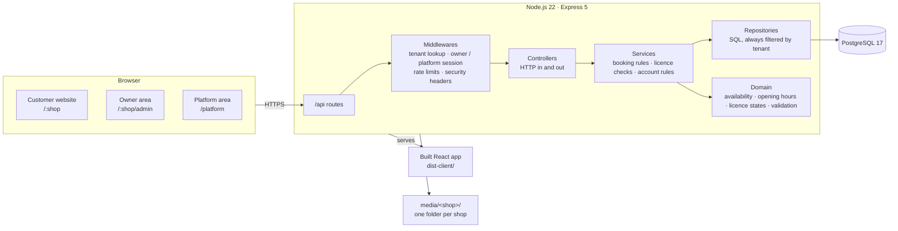
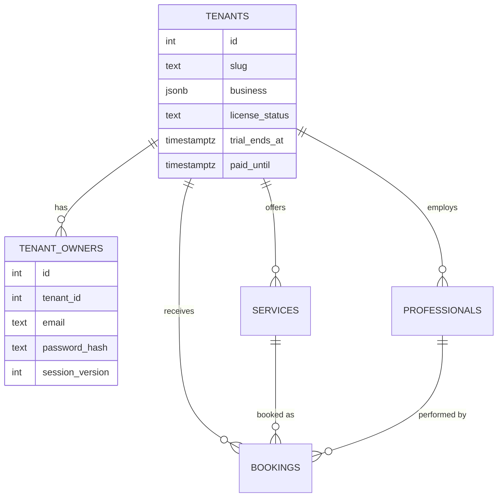
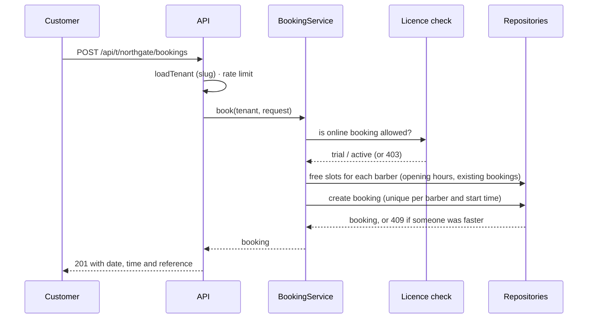

# Barbearia

Online booking software for barbershops. Each barbershop gets its own address, a public
website with services, barbers, opening hours and a booking flow, and an owner area to keep
everything up to date. One installation serves many barbershops (multi-tenant SaaS), and the
platform owner controls each shop's licence from a separate area.

> Sample content in the screenshots (names, prices, address, phone) is invented for the demo.

## Screenshots

| Website | Booking |
| --- | --- |
|  |  |
|  |  |

| Mobile | Owner area |
| --- | --- |
|  |  |

| Owner: services | Platform owner |
| --- | --- |
|  |  |

## Features

**Customers**
- Choose a service, a date and a time. Barbers' availability is respected; a barber can be chosen, or the first free barber is assigned.
- Live booking summary with price, duration and barber.
- Mobile-friendly layout with a booking button that stays in reach.

**Barbershop owners** (`/<shop>/admin`)
- Business profile: name, slogan, about, contact details, address, opening hours, time zone and currency.
- Photos: upload JPG, PNG or WebP files, then choose a hero image and barber portraits.
- Barbers and services: add, rename, set prices, durations and descriptions.
- Account: change password (other sessions are signed out).
- Licence notice: shows whether online booking is open and until when.

**Platform owner** (`/platform`)
- Create barbershops (name, address, owner login). Each one starts with a 14-day trial.
- Set each shop's licence status (trial, active or suspended), trial end and paid-until date.

## Architecture



**Layers.** Routes only wire URLs to handlers. Middlewares resolve the shop (`:slug`), check the
owner or platform session and apply rate limits. Controllers translate HTTP into calls and back.
Services hold the rules (for example: a shop with an expired licence cannot take bookings).
Repositories are the only code that writes SQL, and every query filters by `tenant_id`.
Domain modules are pure functions and types with no I/O, which keeps them easy to test.

### Multi-tenancy

Each barbershop is a **tenant** identified by its address (`/northgate`). All its rows
(services, barbers, bookings, owner accounts, photos) belong to one tenant. Requests for one
shop can never read or change another shop's rows, and owner sessions are bound to a single
shop: a session issued for one shop is rejected by every other shop's API.



### Request flow: a booking



### Licences

A shop's licence decides whether customers can book. The owner area always stays open, so the
owner can see the reason and fix their account.

| Status set by the platform owner | Customers can book? | What the owner sees |
| --- | --- | --- |
| `trial`, before the trial end | Yes | "Free trial: online booking is open until …" |
| `active`, paid until a future date, or with no end date | Yes | "Subscription active …" |
| `trial` or `active` whose period has ended | No | "Online booking is paused because the subscription has ended." |
| `suspended` | No | "Online booking is paused for this account." |

The platform owner changes these in `/platform`. A payment provider would set `paid_until` when a
subscription is paid (see the roadmap).

### Security

- **Owner and platform sessions** are signed tokens (HMAC-SHA256) in `HttpOnly`,
  `SameSite=Strict` cookies, valid for 8 hours. The browser never stores the owner's password or a
  reusable token.
- **Passwords** are hashed with scrypt and a per-password salt. Unknown emails take as long to
  reject as known ones, so timing does not reveal which emails have accounts.
- **Password changes** bump a session version, which signs out every other session.
- **Rate limits** apply to sign-in (10 attempts per 15 minutes per address) and booking
  (30 per 10 minutes per address).
- **Uploads** are checked against the image's signature bytes, renamed on arrival and never
  overwrite an existing photo. Only JPG, PNG and WebP are accepted, up to 8 MB.
- **HTTP headers:** Content-Security-Policy, `X-Content-Type-Options`, `X-Frame-Options`,
  `Referrer-Policy`, `Permissions-Policy`, and HSTS when cookies are secure.
- **Input validation** happens on every endpoint; SQL is always parameterised.

## Project layout

```
src/
  app.ts, server.ts         wiring: Express app and process start
  routes/                   URL → handler map, shop and platform sections
  middlewares/              shop lookup, owner and platform sessions, rate limits, headers
  controllers/              HTTP handlers (request → service → response)
  services/                 booking rules, account rules, owner content rules
  domain/                   pure logic: availability, opening hours, licence states, slugs, defaults
  repositories/             SQL, one file per table, always tenant-scoped
  auth/                     tokens, password hashing, session names
  validations/              input checks for every endpoint
  media/                    per-shop photo storage
  test/                     unit tests (node:test)
client/src/
  pages/                    shop site, shop routing, platform area, landing and not-found
  components/               website sections (hero, barbers, services, booking, visit, footer)
  admin/                    owner area: business, photos, barbers, services, account
db/migrations/              schema, applied once each and recorded in schema_migrations
docs/                       screenshots and legal templates
media/<shop>/               each shop's photos (not committed)
```

## Running it locally

Requirements: Node.js 22 and Docker (or any PostgreSQL 17 server).

```bash
npm install
docker compose up -d                 # PostgreSQL on port 5434
cp .env.example .env                 # then fill in the secrets below
npm run db:migrate
npm run build
npm start                            # http://localhost:3100
```

Generate the secrets:

```bash
openssl rand -hex 32    # SESSION_SECRET
openssl rand -hex 24    # PLATFORM_ADMIN_TOKEN
```

Then open `http://localhost:3100/platform`, sign in with `PLATFORM_ADMIN_TOKEN`, and add the first
barbershop. Its website is at `/<address>` and its owner area at `/<address>/admin`.

For development run `npm run dev:api` and `npm run dev:web` in two terminals.

| Command | What it does |
| --- | --- |
| `npm test` | Builds the server and runs the unit tests. |
| `npm run typecheck` | Type-checks the server and the client. |
| `npm run build` | Builds the server and the website. |

## Configuration

| Variable | Required | Purpose |
| --- | --- | --- |
| `DATABASE_URL` | yes | PostgreSQL connection string. |
| `SESSION_SECRET` | yes, 32+ characters | Signs owner and platform sessions. Changing it signs everyone out. |
| `PLATFORM_ADMIN_TOKEN` | to use `/platform`, 24+ characters | The platform owner's sign-in token. |
| `PORT` | no, default 3100 | Port for the site and API. |
| `COOKIE_SECURE` | no | Send cookies only over HTTPS. On by default in production. |
| `TRUST_PROXY` | no | Set to `true` behind a reverse proxy that sets `X-Forwarded-For`. |

## Business model and licensing

Barbershops pay a monthly or yearly **subscription** to use the hosted service. The code stays
with its owner. Customers receive a licence to use the service, not the software. The usual
choices and what this project does about each:

| Model | Who runs it | Fit for this product |
| --- | --- | --- |
| **Hosted subscription (SaaS)**, one install for many shops | You | Recommended. Recurring revenue, updates in one place, no installs for the customer. Implemented: multi-tenancy, trials, licence states, platform area. |
| **Self-hosted licence** (licence key or annual fee), the shop runs its own copy | The customer | Possible later for shops that insist on their own server. Needs a licence key check and support. Not implemented. |
| **Open source** with a commercial add-on | Anyone | Not recommended if the goal is to sell this product; others can copy it. |

The project is **proprietary**. [`LICENSE`](LICENSE) says who owns the code, what customers may do and what they
may not. The customer agreement lives in [`docs/legal/termos-de-uso.md`](docs/legal/termos-de-uso.md) and the
privacy policy in [`docs/legal/politica-de-privacidade.md`](docs/legal/politica-de-privacidade.md).
These are templates; have a lawyer adapt them before you sell.

**Roadmap for billing.** Connect a payment provider (for example Stripe, Mercado Pago or Paddle) so that
a successful payment sets `paid_until` and a failed or cancelled one moves the shop to `suspended`.
Until then the platform owner sets licences by hand in `/platform`.

## Testing and CI

- `npm test` runs 53 unit tests: availability, booking rules across barbershops, licence states,
  password hashing and signed tokens, rate limits, uploads, slugs and input validation.
- A GitHub Actions workflow (`.github/workflows/ci.yml`) builds and tests every push and pull request.

## Roadmap

- Payment integration and automatic licence updates.
- Custom domains for each barbershop.
- E-mail confirmations and reminders.
- A bookings list and cancellations for the owner.
- Multiple owner accounts per shop.

## Sobre o autor

Olá, eu sou o Alexandro Cunha ([@AlexandroCunha](https://github.com/AlexandroCunha)). Trabalho com
desenvolvimento back-end, principalmente com Node.js, TypeScript e PostgreSQL. Sou autor do
**Financify**, uma API REST de finanças pessoais feita com Express 5, PostgreSQL e JWT, e deste projeto,
o Barbearia, que construí do zero para mostrar como um sistema de agendamentos pode atender várias
barbearias com licenças, segurança e uma área do proprietário simples.

Neste projeto, cuidei da modelagem multi-tenant, das regras de agendamento e de licença, da autenticação
e da interface. Se quiser conversar sobre o sistema, sobre back-end ou sobre como levar o produto para
barbearias, fale comigo pelo GitHub.

[Complete aqui com sua formação, experiência e forma de contato.]
