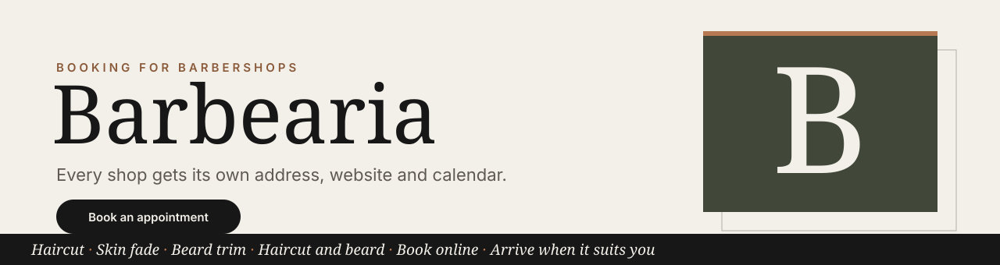
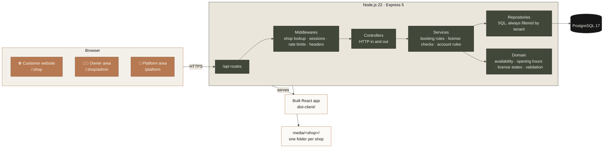
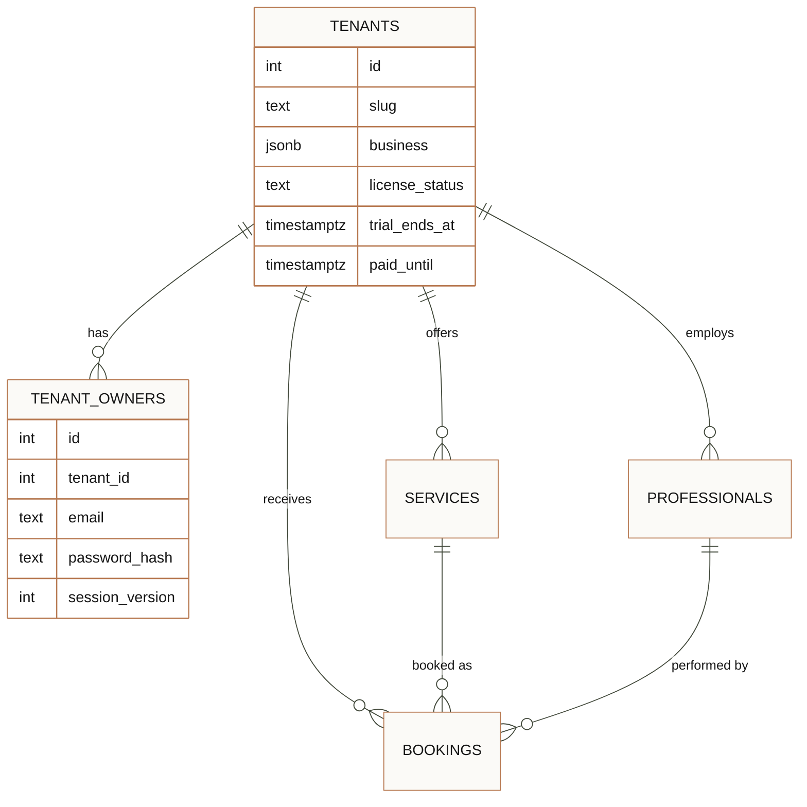
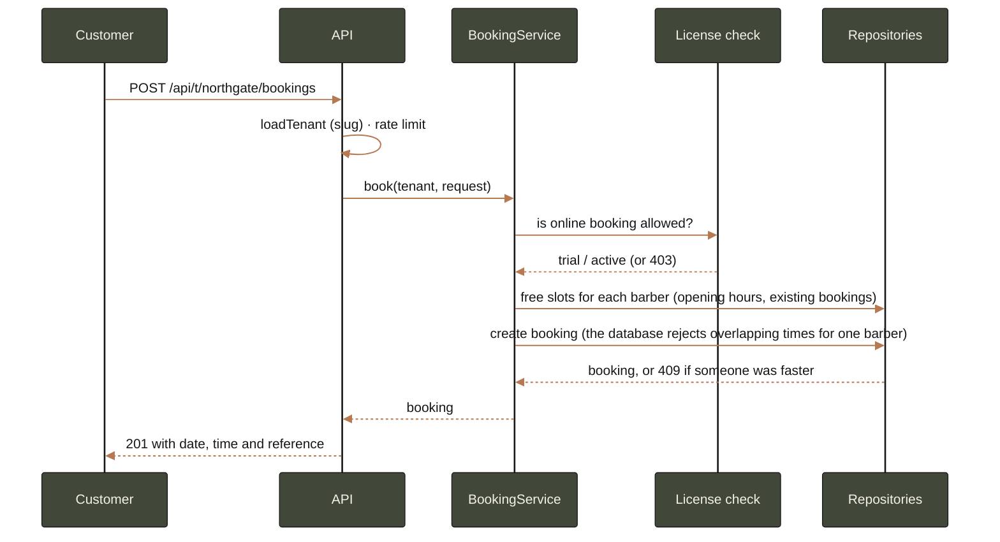

<div align="center">



**Online booking for barbershops, made simple.** Every shop gets its own address, a beautiful website,
a booking calendar and an owner area. One installation serves many shops.

[](https://github.com/AlexandroCunha/barbearia/actions/workflows/ci.yml)


<br>

[](#-take-a-look)
[](#-what-you-get)
[](#-quick-start)
[](#-how-it-works)
[](#-testing--ci)

**🇬🇧 English** · [🇧🇷 Português](README.pt-BR.md)

</div>

> 🧪 All names, prices, addresses and phone numbers in the screenshots are invented for the demo.

---

## 👀 Take a look

<p align="center">
  
</p>

---

## ✨ What you get

<table>
  <tr>
    <td valign="top" width="33%">

### 💈 Customers
- Pick a service, a day and a time
- Choose a barber, or let us find the first free one
- A live summary with price and duration
- Smooth on phones, with the booking button always in reach

</td>
    <td valign="top" width="33%">

### 🧑‍💼 Owners
- Business profile: name, slogan, contacts, address, hours
- Upload photos and pick a hero image and barber portraits
- Add, rename, reprice and remove barbers and services
- Change your password; other devices sign out
- See at a glance whether online booking is open

</td>
    <td valign="top" width="33%">

### 🏢 Platform owner
- Create a barbershop in one form (14-day trial included)
- Set each shop's license: trial, active or suspended
- Set trial end and paid-until dates

</td>
  </tr>
</table>

<p align="center">
  <sub>🎨 Same palette as the website:</sub><br>
  
  
  
  
</p>

---

## 🚀 Quick start

You need **Node.js 22** and **Docker** (or any PostgreSQL 17 server).

```bash
npm install
docker compose up -d            # PostgreSQL on port 5434
cp .env.example .env            # then fill in the two secrets below
npm run db:migrate
npm run build
npm start                       # http://localhost:3100
```

Create the two secrets:

```bash
openssl rand -hex 32            # SESSION_SECRET
openssl rand -hex 24            # PLATFORM_ADMIN_TOKEN
```

Then open **`http://localhost:3100/platform`**, sign in with `PLATFORM_ADMIN_TOKEN`, and add your first
barbershop. Its website lives at `/<address>` and its owner area at `/<address>/admin`. 🎉

> 💡 For development, run `npm run dev:api` and `npm run dev:web` in two terminals.

| Command | What it does |
| --- | --- |
| `npm test` | Builds the server and runs the unit tests |
| `npm run simulate` | Runs an end-to-end simulation with ten agents (see [Testing](#-testing--ci)) |
| `npm run typecheck` | Type-checks the server and the website |
| `npm run build` | Builds the server and the website |

---

## 🧭 How it works

Each barbershop is a **tenant** with its own address (`/northgate`). Its services, barbers,
bookings, owner accounts and photos never mix with another shop's data.



**In short:** routes wire URLs to handlers, middlewares check who you are, controllers translate HTTP,
services hold the rules, and repositories are the only code that talks SQL. Every query filters by
`tenant_id`, so one shop can never see another's data.

### 🗂️ Data model



### 📅 A booking, step by step



### 🎟️ Licenses

A shop's license decides whether customers can book. The owner area always stays open, so the owner
can see the reason and fix it.

| Status set by the platform owner | Customers can book? | What the owner sees |
| --- | :---: | --- |
| `trial`, before the trial ends | ✅ | "Free trial: online booking is open until …" |
| `active`, paid until a future date, or with no end date | ✅ | "Subscription active …" |
| `trial` or `active` whose period has ended | ⛔ | "Online booking is paused because the subscription has ended." |
| `suspended` | ⛔ | "Online booking is paused for this account." |

### 🔐 Security

- 🍪 **Sessions** are signed tokens (HMAC-SHA256) in `HttpOnly`, `SameSite=Strict` cookies, valid for 8 hours. The browser never keeps a reusable token.
- 🔑 **Passwords** are hashed with scrypt and a per-password salt. Unknown emails take as long to reject as real ones, so timing reveals nothing.
- 🚪 **Password changes** sign out every other session.
- 🚦 **Rate limits:** sign-in (10 attempts per 15 minutes) and booking (30 per 10 minutes), per address.
- 🖼️ **Uploads** are checked against the image's signature bytes, renamed on arrival, and never overwrite a photo. JPG, PNG and WebP only, up to 8 MB.
- 🛡️ **Headers:** Content-Security-Policy, `X-Content-Type-Options`, `X-Frame-Options`, `Referrer-Policy`, `Permissions-Policy`, and HSTS when cookies are secure.
- ✅ **Inputs** are validated on every endpoint, and SQL is always parameterised.

---

## 🗺️ Project layout

```
src/
  app.ts, server.ts         wiring: Express app and process start
  routes/                   URL → handler map, shop and platform sections
  middlewares/              shop lookup, owner and platform sessions, rate limits, headers
  controllers/              HTTP handlers (request → service → response)
  services/                 booking rules, account rules, owner content rules
  domain/                   pure logic: availability, opening hours, license states, slugs, defaults
  repositories/             SQL, one file per table, always tenant-scoped
  auth/                     tokens, password hashing, session names
  validations/              input checks for every endpoint
  media/                    per-shop photo storage
  test/                     unit tests (node:test)
client/src/
  pages/                    shop site, shop routing, platform area, landing and not-found
  components/               website sections (hero, barbers, services, booking, visit, footer)
  admin/                    owner area: business, photos, barbers, services, account
db/migrations/              schema, applied once each and recorded in schema_migrations
scripts/                    end-to-end simulation
docs/                       banner, screenshots and legal templates
media/<shop>/               each shop's photos (not committed)
```

---

## ⚙️ Configuration

| Variable | Required | What it does |
| --- | :---: | --- |
| `DATABASE_URL` | ✅ | PostgreSQL connection string |
| `SESSION_SECRET` | ✅ (32+ chars) | Signs owner and platform sessions. Changing it signs everyone out |
| `PLATFORM_ADMIN_TOKEN` | for `/platform` (24+ chars) | The platform owner's sign-in token |
| `PORT` | | Port for the site and API. Default `3100` |
| `COOKIE_SECURE` | | Send cookies only over HTTPS. On by default in production |
| `TRUST_PROXY` | | Set to `true` behind a reverse proxy that sets `X-Forwarded-For` |
| `BOOKING_RATE_LIMIT` | | Booking requests allowed per address in 10 minutes. Default `30` |

---

## 🧪 Testing & CI

- ✅ **`npm test`**: 53 unit tests covering availability, cross-shop booking rules, license states,
  password hashing, signed tokens, rate limits, uploads, slugs and input validation.
- 🤖 **`npm run simulate`**: an end-to-end run with ten agents (one owner, three new barbers, six
  customers) hitting the same slot at the same time, removing items, trying overlaps, suspending a
  shop and changing passwords. Start the server with a higher limit first:
  `BOOKING_RATE_LIMIT=500 npm start`. It also needs `psql` on the PATH, or `PSQL` set to its path.
- 🔁 **GitHub Actions** builds and tests every push and pull request.

---

## 💼 Business model and licensing

Barbershops pay a **subscription** to use the hosted service. The code stays with its owner, and
customers receive a license to use the service, not the software.

| Model | Who runs it | Fit for this product |
| --- | --- | --- |
| ☁️ **Hosted subscription (SaaS)**, one install for many shops | You | **Recommended.** Recurring revenue, one place to update. Implemented: multi-tenancy, trials, license states, platform area. |
| 🏠 **Self-hosted license** (license key or annual fee) | The customer | Possible later for shops that want their own server. Not implemented. |
| 🌍 **Open source** with a paid add-on | Anyone | Not recommended if the goal is to sell this product. |

The project is **proprietary**. [`LICENSE`](LICENSE) explains who owns the code and what customers may
and may not do. The customer agreement and privacy policy are in
[`docs/legal/terms-of-service.md`](docs/legal/terms-of-service.md) and
[`docs/legal/privacy-policy.md`](docs/legal/privacy-policy.md). They are templates, so have a lawyer
adapt them before you sell.

---

## 🛣️ Roadmap

- 💳 Payments, with licenses that update automatically
- 🌐 A custom domain for each barbershop
- 📧 E-mail confirmations and reminders
- 📋 A bookings list and cancellations for the owner
- 👥 Several owner accounts per shop

---

## 👨‍💻 About the author

Hi, I'm **Alexandro Cunha** ([@AlexandroCunha](https://github.com/AlexandroCunha)). I work on
back-end development, mainly with Node.js, TypeScript and PostgreSQL. I'm the author of **Financify**, a
personal finance REST API built with Express 5, PostgreSQL and JWT, and of this project, which I built
from scratch to show how a booking system can serve many barbershops with licenses, security and a
simple owner area.

In this project I designed the multi-tenant model, the booking and license rules, the authentication and
the user interface. Want to talk about the system, back-end work, or bringing this product to barbershops?
Reach out on GitHub. 👋

[Complete with your education, experience and contact details.]

---

<div align="center">


Made with ☕ and a lot of careful testing · [🇧🇷 Leia em português](README.pt-BR.md)

</div>
