<div align="center">

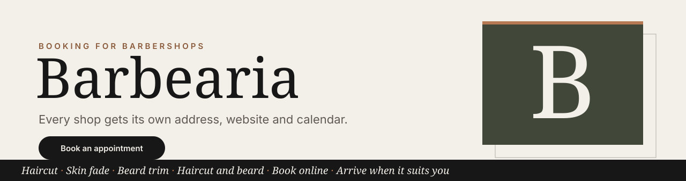

**Agendamento online para barbearias, de forma simples.** Cada barbearia ganha o próprio endereço, um site
bonito, uma agenda de horários e uma área do dono. Uma única instalação atende muitas barbearias.

[](https://github.com/AlexandroCunha/barbearia/actions/workflows/ci.yml)


<br>

[](#-dê-uma-olhada)
[](#-o-que-você-ganha)
[](#-início-rápido)
[](#-como-funciona)
[](#-testes-e-ci)

[🇬🇧 English](README.md) · **🇧🇷 Português**

</div>

> 🧪 Todos os nomes, preços, endereços e telefones das capturas de tela são fictícios, criados para a demonstração.

---

## 👀 Dê uma olhada

<table>
  <tr>
    <td colspan="2" align="center">
      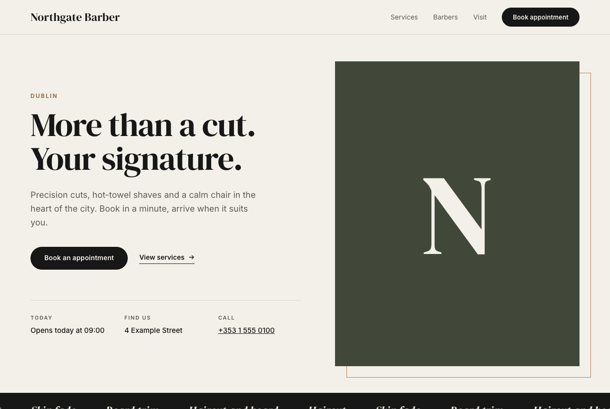<br>
      <sub><b>O site</b>: uma primeira impressão que combina com a barbearia</sub>
    </td>
  </tr>
  <tr>
    <td width="50%" valign="top" align="center">
      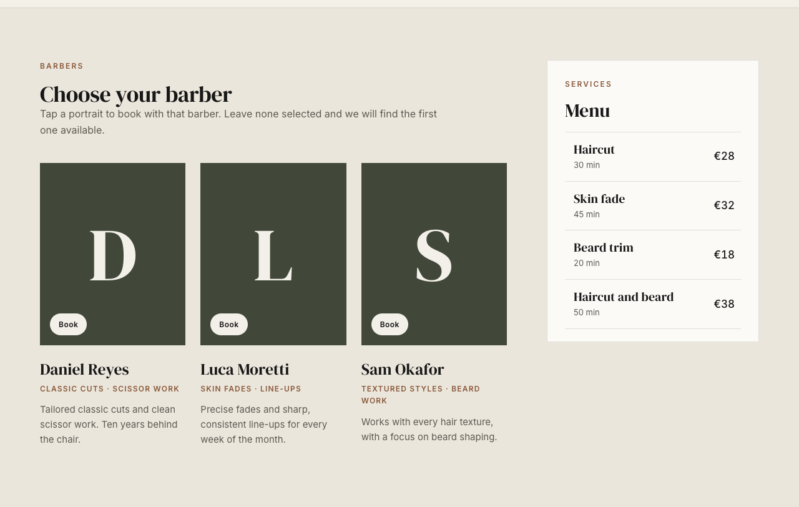<br>
      <sub><b>Barbeiros e serviços</b>: escolha um barbeiro e um serviço lado a lado</sub>
    </td>
    <td width="50%" valign="top" align="center">
      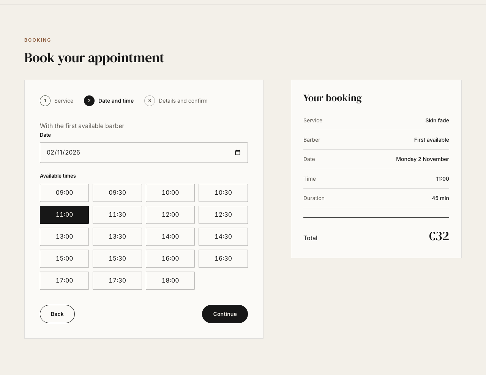<br>
      <sub><b>Agendamento</b>: escolha um dia e um horário livre</sub>
    </td>
  </tr>
  <tr>
    <td colspan="2" align="center">
      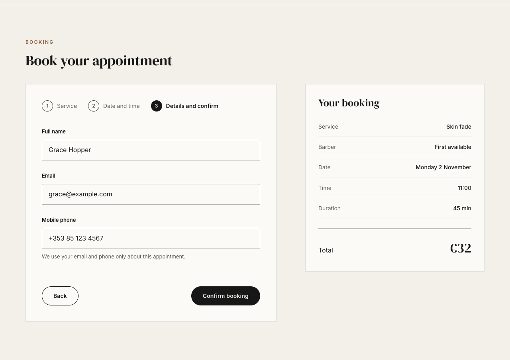<br>
      <sub><b>Confirmação</b>: um resumo ao vivo do atendimento</sub>
    </td>
  </tr>
  <tr>
    <td width="50%" valign="top" align="center">
      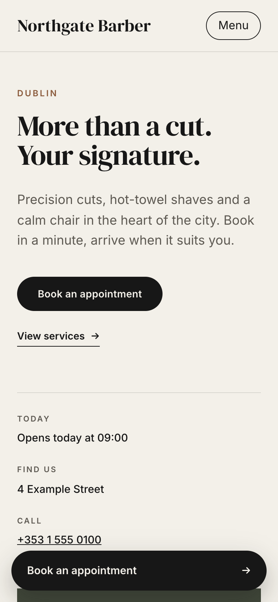<br>
      <sub><b>Feito para o celular</b>: fica ótimo no telefone</sub>
    </td>
    <td width="50%" valign="top" align="center">
      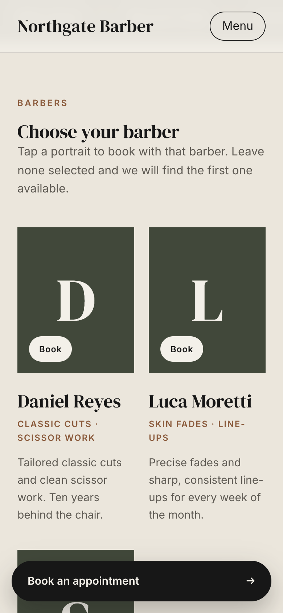<br>
      <sub><b>Barbeiros no celular</b>: a equipe a um toque de distância</sub>
    </td>
  </tr>
  <tr>
    <td width="50%" valign="top" align="center">
      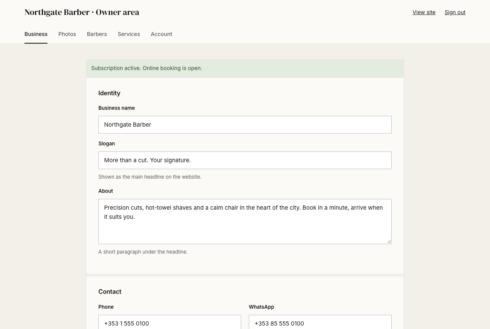<br>
      <sub><b>Área do dono</b>: o dono edita tudo sem mexer em código</sub>
    </td>
    <td width="50%" valign="top" align="center">
      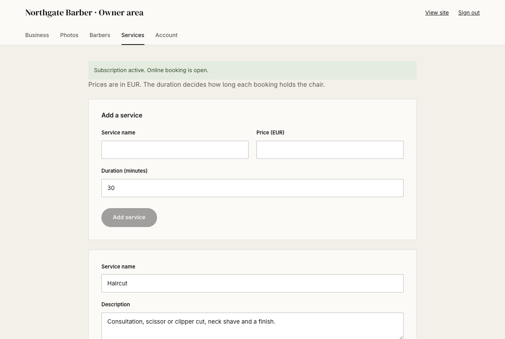<br>
      <sub><b>Serviços</b>: preços, durações e descrições</sub>
    </td>
  </tr>
  <tr>
    <td colspan="2" align="center">
      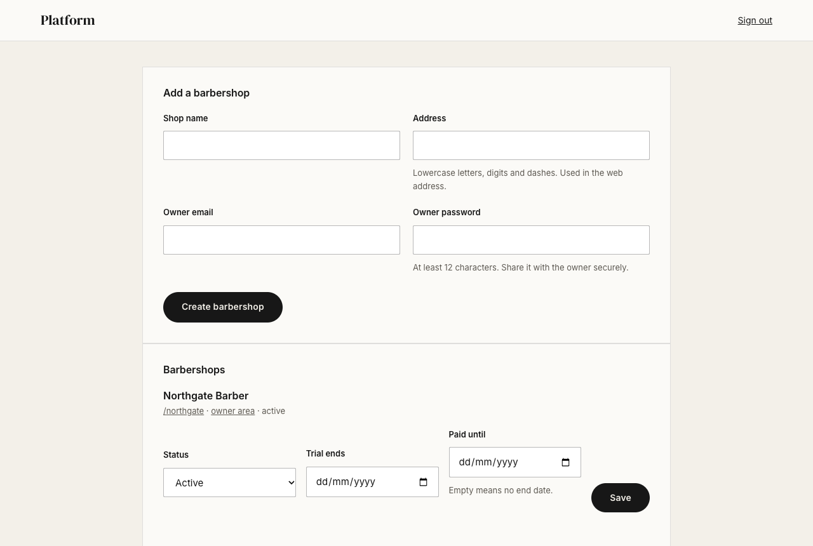<br>
      <sub><b>Dono da plataforma</b>: todas as barbearias e suas licenças em um lugar</sub>
    </td>
  </tr>
</table>

---

## ✨ O que você ganha

<table>
  <tr>
    <td valign="top" width="33%">

### 💈 Clientes
- Escolha um serviço, um dia e um horário
- Escolha um barbeiro, ou deixe o sistema achar o primeiro livre
- Um resumo ao vivo com preço e duração
- Funciona bem no celular, com o botão de agendar sempre à mão

</td>
    <td valign="top" width="33%">

### 🧑‍💼 Donos
- Perfil do negócio: nome, slogan, contatos, endereço e horários
- Envie fotos e escolha a foto de destaque e os retratos dos barbeiros
- Adicione, renomeie, mude preços e remova barbeiros e serviços
- Troque a senha; os outros aparelhos são desconectados
- Veja de relance se o agendamento online está aberto

</td>
    <td valign="top" width="33%">

### 🏢 Dono da plataforma
- Crie uma barbearia em um formulário (com 14 dias de teste grátis)
- Defina a licença de cada barbearia: teste, ativa ou suspensa
- Defina a data de fim do teste e até quando está pago

</td>
  </tr>
</table>

<p align="center">
  <sub>🎨 A mesma paleta do site:</sub><br>
  
  
  
  
</p>

---

## 🚀 Início rápido

Você precisa de **Node.js 22** e **Docker** (ou qualquer servidor PostgreSQL 17).

```bash
npm install
docker compose up -d            # PostgreSQL na porta 5434
cp .env.example .env            # depois preencha os dois segredos abaixo
npm run db:migrate
npm run build
npm start                       # http://localhost:3100
```

Crie os dois segredos:

```bash
openssl rand -hex 32            # SESSION_SECRET
openssl rand -hex 24            # PLATFORM_ADMIN_TOKEN
```

Depois abra **`http://localhost:3100/platform`**, entre com o `PLATFORM_ADMIN_TOKEN` e cadastre a
primeira barbearia. O site dela fica em `/<endereço>` e a área do dono em `/<endereço>/admin`. 🎉

> 💡 Para desenvolver, rode `npm run dev:api` e `npm run dev:web` em dois terminais.

| Comando | O que faz |
| --- | --- |
| `npm test` | Compila o servidor e roda os testes unitários |
| `npm run simulate` | Roda uma simulação completa com dez agentes (veja [Testes](#-testes-e-ci)) |
| `npm run typecheck` | Verifica os tipos do servidor e do site |
| `npm run build` | Compila o servidor e o site |

---

## 🧭 Como funciona

Cada barbearia é um **tenant**, com endereço próprio (`/northgate`). Os serviços, barbeiros,
agendamentos, contas de dono e fotos dela nunca se misturam com os de outra barbearia.

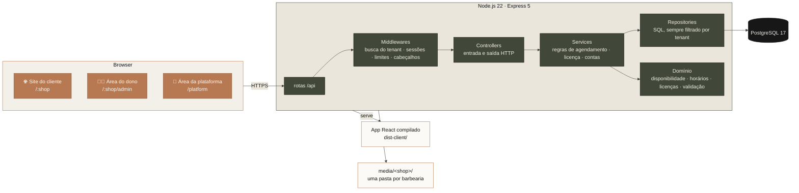

**Em resumo:** as rotas ligam URLs aos handlers, os middlewares verificam quem é você, os controllers
traduzem o HTTP, os services guardam as regras, e os repositories são o único código que fala SQL.
Toda consulta filtra por `tenant_id`, então uma barbearia nunca vê os dados de outra.

### 🗂️ Modelo de dados

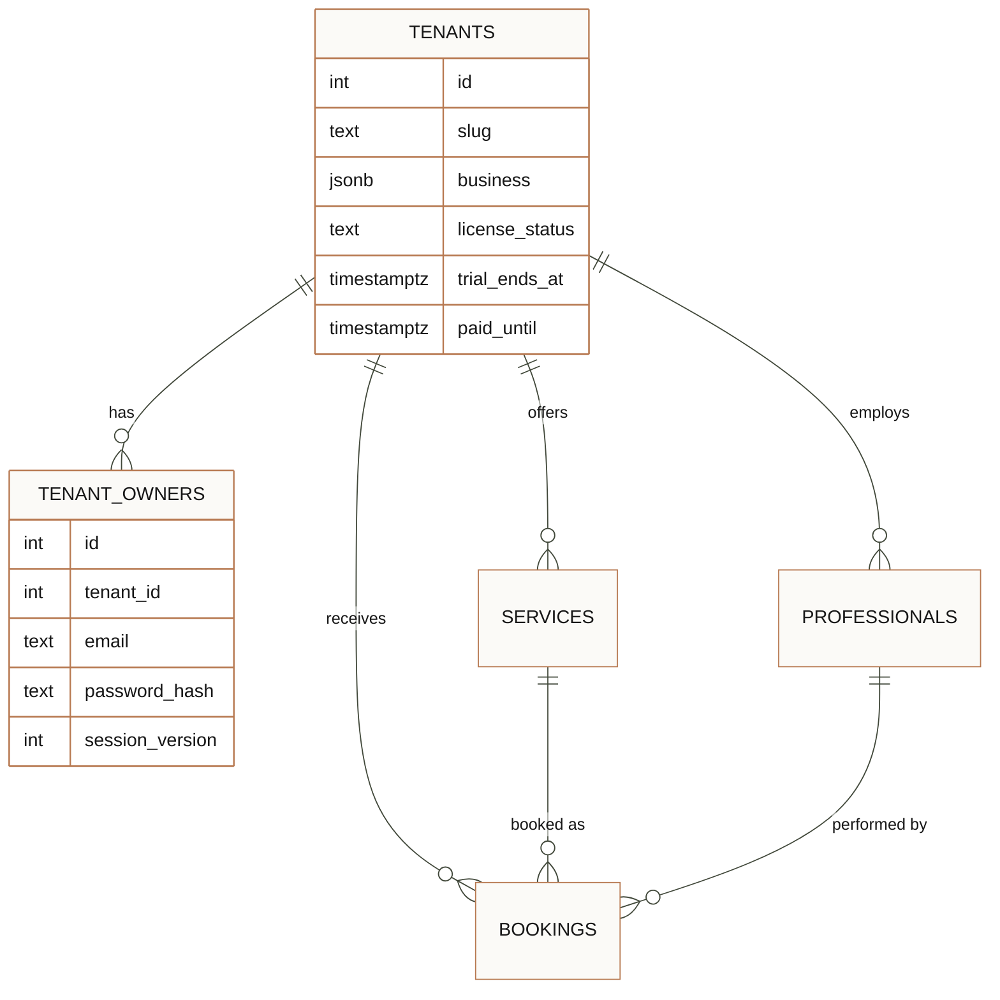

### 📅 Um agendamento, passo a passo

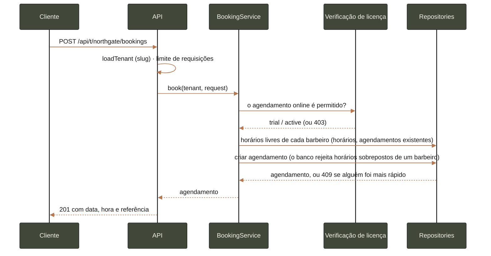

### 🎟️ Licenças

A licença da barbearia decide se os clientes podem agendar. A área do dono fica sempre aberta, para
que ela veja o motivo e resolva.

| Status definido pelo dono da plataforma | Clientes podem agendar? | O que o dono vê |
| --- | :---: | --- |
| `trial`, antes do fim do teste | ✅ | "Teste grátis: agendamento online aberto até …" |
| `active`, pago até uma data futura, ou sem data de fim | ✅ | "Assinatura ativa …" |
| `trial` ou `active` com o período encerrado | ⛔ | "O agendamento online está pausado porque a assinatura terminou." |
| `suspended` | ⛔ | "O agendamento online está pausado para esta conta." |

### 🔐 Segurança

- 🍪 **Sessões** são tokens assinados (HMAC-SHA256) em cookies `HttpOnly` e `SameSite=Strict`, válidos por 8 horas. O navegador nunca guarda um token reutilizável.
- 🔑 **Senhas** são guardadas com scrypt e um sal próprio de cada senha. E-mails desconhecidos levam o mesmo tempo para serem recusados que os reais, então o tempo de resposta não revela nada.
- 🚪 **Trocar a senha** desconecta todas as outras sessões.
- 🚦 **Limites de requisições:** login (10 tentativas em 15 minutos) e agendamento (30 em 10 minutos), por endereço.
- 🖼️ **Uploads** são conferidos pelos bytes de assinatura da imagem, recebem um novo nome ao chegar e nunca sobrescrevem uma foto. Só JPG, PNG e WebP, até 8 MB.
- 🛡️ **Cabeçalhos:** Content-Security-Policy, `X-Content-Type-Options`, `X-Frame-Options`, `Referrer-Policy`, `Permissions-Policy`, e HSTS quando os cookies são seguros.
- ✅ **Entradas** são validadas em todos os endpoints, e o SQL é sempre parametrizado.

---

## 🗺️ Estrutura do projeto

```
src/
  app.ts, server.ts         montagem: app Express e início do processo
  routes/                   mapa de URL → handler, seções da barbearia e da plataforma
  middlewares/              busca da barbearia, sessões de dono e plataforma, limites, cabeçalhos
  controllers/              handlers HTTP (requisição → service → resposta)
  services/                 regras de agendamento, de contas e do conteúdo do dono
  domain/                   lógica pura: disponibilidade, horários, estados de licença, slugs, padrões
  repositories/             SQL, um arquivo por tabela, sempre filtrado por tenant
  auth/                     tokens, hash de senhas, nomes de sessão
  validations/              verificação de entrada de cada endpoint
  media/                    armazenamento de fotos por barbearia
  test/                     testes unitários (node:test)
client/src/
  pages/                    site da barbearia, roteamento, área da plataforma, página inicial e 404
  components/               seções do site (topo, barbeiros, serviços, agendamento, visita, rodapé)
  admin/                    área do dono: negócio, fotos, barbeiros, serviços, conta
db/migrations/              esquema, aplicado uma vez cada e registrado em schema_migrations
scripts/                    simulação completa
docs/                       banner, capturas de tela e modelos jurídicos
media/<shop>/               as fotos de cada barbearia (não versionadas)
```

---

## ⚙️ Configuração

| Variável | Obrigatória | O que faz |
| --- | :---: | --- |
| `DATABASE_URL` | ✅ | String de conexão com o PostgreSQL |
| `SESSION_SECRET` | ✅ (32+ caracteres) | Assina as sessões do dono e da plataforma. Trocar desconecta todo mundo |
| `PLATFORM_ADMIN_TOKEN` | para `/platform` (24+ caracteres) | O token de acesso do dono da plataforma |
| `PORT` | | Porta do site e da API. Padrão `3100` |
| `COOKIE_SECURE` | | Envia cookies só por HTTPS. Ligada por padrão em produção |
| `TRUST_PROXY` | | Use `true` atrás de um proxy reverso que envie `X-Forwarded-For` |
| `BOOKING_RATE_LIMIT` | | Agendamentos permitidos por endereço em 10 minutos. Padrão `30` |

---

## 🧪 Testes e CI

- ✅ **`npm test`**: 53 testes unitários cobrindo disponibilidade, regras de agendamento entre barbearias, estados de licença, hash de senhas, tokens assinados, limites de requisições, uploads, slugs e validação de entradas.
- 🤖 **`npm run simulate`**: uma simulação completa com dez agentes (um dono, três barbeiros novos e seis clientes) disputando o mesmo horário ao mesmo tempo, removendo itens, tentando sobreposições, suspendendo uma barbearia e trocando senhas. Antes, suba o servidor com um limite maior: `BOOKING_RATE_LIMIT=500 npm start`. Também é preciso ter o `psql` no PATH, ou definir `PSQL` com o caminho dele.
- 🔁 **GitHub Actions** compila e testa cada push e pull request.

---

## 💼 Modelo de negócio e licenciamento

As barbearias pagam uma **assinatura** para usar o serviço hospedado. O código continua com o dono,
e os clientes recebem uma licença para usar o serviço, não o software.

| Modelo | Quem opera | Adequação ao produto |
| --- | --- | --- |
| ☁️ **Assinatura hospedada (SaaS)**, uma instalação para muitas barbearias | Você | **Recomendado.** Receita recorrente, uma só versão para atualizar. Implementado: multi-tenant, testes grátis, estados de licença, área da plataforma. |
| 🏠 **Licença para instalação própria** (chave de licença ou taxa anual) | O cliente | Possível no futuro para barbearias que querem o próprio servidor. Não implementado. |
| 🌍 **Código aberto** com um complemento pago | Qualquer um | Não recomendado se o objetivo é vender este produto. |

O projeto é **proprietário**. O arquivo [`LICENSE`](LICENSE) explica quem é dono do código e o que os
clientes podem e não podem fazer. O contrato com o cliente e a política de privacidade estão em
[`docs/legal/terms-of-service.md`](docs/legal/terms-of-service.md) e
[`docs/legal/privacy-policy.md`](docs/legal/privacy-policy.md). São modelos, então um advogado deve
adaptá-los antes da venda.

---

## 🛣️ Roadmap

- 💳 Pagamentos, com licenças que se atualizam sozinhas
- 🌐 Um domínio próprio para cada barbearia
- 📧 Confirmações e lembretes por e-mail
- 📋 Lista de agendamentos e cancelamentos para o dono
- 👥 Várias contas de dono por barbearia

---

## 👨‍💻 Sobre o autor

Olá, eu sou o **Alexandro Cunha** ([@AlexandroCunha](https://github.com/AlexandroCunha)). Trabalho com
desenvolvimento back-end, principalmente com Node.js, TypeScript e PostgreSQL. Sou o autor do **Financify**,
uma API REST de finanças pessoais feita com Express 5, PostgreSQL e JWT, e deste projeto, que construí do
zero para mostrar como um sistema de agendamentos pode atender várias barbearias com licenças, segurança
e uma área do dono simples.

Neste projeto, desenhei o modelo multi-tenant, as regras de agendamento e de licença, a autenticação e a
interface. Quer conversar sobre o sistema, sobre back-end, ou sobre levar este produto para barbearias?
Me chame pelo GitHub. 👋

[Complete com sua formação, experiência e dados de contato.]

---

<div align="center">


Feito com ☕ e muitos testes cuidadosos · [🇬🇧 Read in English](README.md)

</div>
